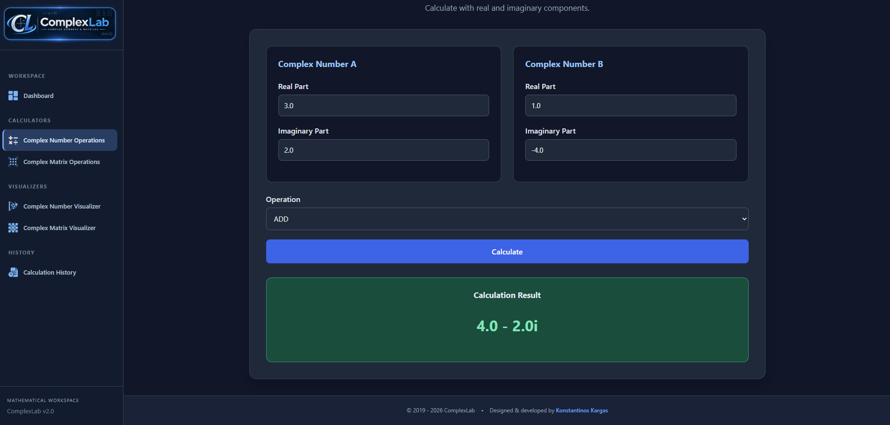
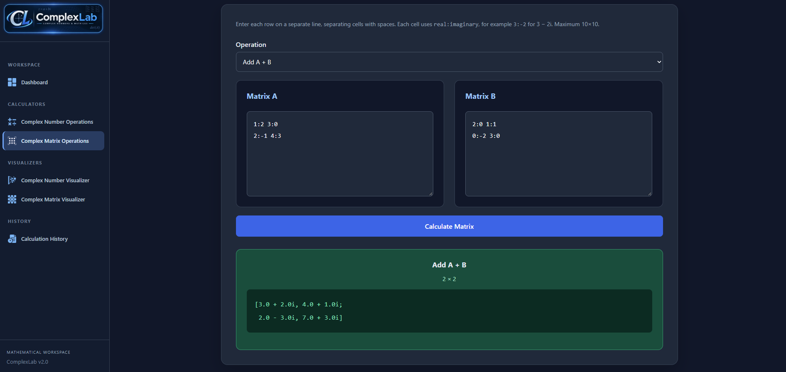
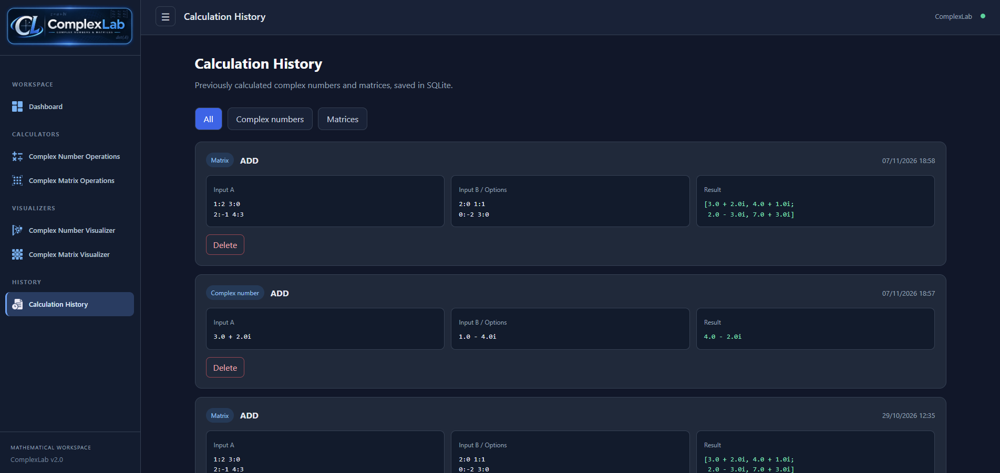

<div align="center">


# ComplexLab

### Complex Number & Matrix Mathematics Platform

An interactive mathematical workspace for **complex arithmetic**, **complex matrices**, and **dynamic visualization**, developed with Java and Spring Boot.


[Overview](#overview) · [Features](#core-features) · [Screenshots](#application-screenshots) · [Technology Stack](#technology-stack) · [Getting Started](#getting-started)

</div>

---

## Overview

**ComplexLab** is a full-stack mathematical application focused on complex numbers and matrices with complex-valued entries. Originating from a **2019 university assignment**, it has been redesigned as a responsive web platform with reusable mathematical components, intuitive calculation interfaces, interactive visualizers, and locally persisted calculation history.

The application combines a Java-based mathematical core and a Spring MVC backend with Thymeleaf-rendered pages and client-side visualizations.

## Core Features

| Module | Capabilities |
| --- | --- |
| **Complex Number Calculator** | Addition, subtraction, multiplication, division, input validation, and formatted results. |
| **Complex Matrix Calculator** | Addition, subtraction, multiplication, complex scalar multiplication, transposition, conjugate transpose, determinant, trace, inverse, powers, and identity matrices. |
| **Complex Number Visualizer** | Interactive Argand plane, vector operations, draggable endpoints, magnitude, argument, and adjustable scale. |
| **Complex Matrix Visualizer** | Interactive heatmap of complex-valued matrix entries, including real/imaginary components, magnitude, argument, and selected-cell inspection. |
| **Calculation History** | SQLite-backed storage, filtering by calculation type, newest-first browsing, and record deletion. |
| **Responsive Interface** | Dashboard, reusable navigation fragments, and custom branded PNG icons. |

### Complex Number Operations

Perform the four basic arithmetic operations on complex numbers and review formatted results. Successful operations can be saved to calculation history.

### Complex Matrix Operations

Create and calculate with matrices of up to **10 × 10** complex-valued entries. Operations include determinant and inverse calculations where mathematically defined, as well as matrix powers and randomized matrices.

**Input format:** Place each matrix row on a separate line, separate entries with spaces, and write each complex value as `real:imaginary`. For example, `3:-2` represents `3 − 2i`.

### Interactive Visualizers

The complex-number visualizer represents numbers and vector operations geometrically on the complex plane. The matrix visualizer offers a cell-based heatmap for examining individual entries and switching between different properties of complex numbers.

### Calculation History

Completed calculations are stored locally in SQLite, making it possible to revisit results, filter complex-number and matrix operations, and remove unwanted entries.

---

## Application Screenshots

### Dashboard

The main entry point for navigating between calculators, interactive visualizations, and calculation history.


### Complex Number Operations

Arithmetic calculations with complex numbers and formatted results.



### Complex Matrix Operations

Matrix calculations with complex-valued elements.



### Complex Number Visualizer

Interactive representation of complex numbers and vector operations on the Argand plane.


### Complex Matrix Visualizer

Visual exploration of real and imaginary components, magnitude, and argument across a matrix.


### Calculation History

Locally saved calculations available for inspection and management.



---

## Technology Stack

| Layer | Technology |
| --- | --- |
| Language | Java 21 |
| Backend | Spring Boot 4.1.2, Spring MVC |
| Frontend | Thymeleaf, HTML5, CSS3, vanilla JavaScript, Canvas |
| Persistence | Spring Data JPA, Hibernate ORM, SQLite JDBC |
| Build & Dependency Management | Apache Maven, Maven Wrapper |
| Testing | JUnit, Spring Boot Test |

## Application Architecture

ComplexLab separates its application concerns into layers:

1. **Controller layer** — Handles web requests, form submissions, and navigation.
2. **Service layer** — Coordinates mathematical operations and persistence.
3. **Domain model** — Encapsulates complex-number and matrix operations.
4. **Repository layer** — Stores and retrieves calculation history via Spring Data JPA.
5. **Presentation layer** — Uses Thymeleaf for server-rendered views and JavaScript for visualization.

## Application Pages

| Page | Route |
| --- | --- |
| Dashboard | `/` |
| Complex Number Calculator | `/calculator` |
| Complex Matrix Calculator | `/matrix` |
| Complex Number Visualizer | `/visualizer` |
| Complex Matrix Visualizer | `/matrix-visualizer` |
| Calculation History | `/history` |

---

## Getting Started

### Prerequisites

- **JDK 21 or later** (the project targets Java 21)
- Maven or the included Maven Wrapper
- A modern web browser

### 1. Clone the Repository

```bash
git clone https://github.com/KonKargas/ComplexLab.git
cd ComplexLab
```

### 2. Prepare Local Storage

The `data/` directory is supplied with a `.gitkeep` file. The SQLite JDBC driver creates `data/complexlab.db` on startup if the directory is present and writable. The database file is not tracked by Git.

### 3. Run the Application

**Windows:**

```powershell
.\mvnw.cmd spring-boot:run
```

**macOS / Linux:**

```bash
./mvnw spring-boot:run
```

Alternatively, when Maven is installed:

```bash
mvn spring-boot:run
```

Then open **http://localhost:8080/** in your browser.

> **Database path:** The SQLite database location is relative to the working directory. Run the app from the repository root, or set `COMPLEXLAB_DB_URL` to a custom JDBC URL such as `jdbc:sqlite:/absolute/path/complexlab.db`.

### 4. Run the Tests

```bash
./mvnw test
```

On Windows, use `mvnw.cmd test`.

---

## Project Structure

```text
ComplexLab/
├── data/                         # Local SQLite storage directory
├── docs/
│   └── screenshots/              # Application screenshots
├── src/
│   ├── main/
│   │   ├── java/com/kkargas/complexlab/
│   │   │   ├── controller/       # MVC request handlers
│   │   │   ├── dto/              # Form / response objects
│   │   │   ├── enums/            # Mathematical operation types
│   │   │   ├── model/            # Mathematical and history models
│   │   │   ├── repository/       # History persistence
│   │   │   └── service/          # Business and mathematical logic
│   │   └── resources/
│   │       ├── static/           # CSS, JS, icons, and logo
│   │       ├── templates/        # Thymeleaf views and fragments
│   │       └── application.properties
│   └── test/                     # Automated tests
├── .gitignore
├── pom.xml
├── mvnw
└── mvnw.cmd
```

## Data & Privacy

Calculation history is stored **locally** in `data/complexlab.db`. Database files and journals, IDE-specific files, and generated build artifacts are excluded from version control.

The current `spring.jpa.hibernate.ddl-auto=update` configuration is convenient for development but should not be treated as a substitute for managed production database migrations. Back up local data before destructive schema changes.

## Project Background

ComplexLab is the modern continuation of an academic software project originally developed in **2019**. The new web-based version retains its mathematical focus while extending it with responsive user interfaces, interactive visualizations, and persistent calculation history.

## License

No distribution license has been selected for this repository. Until a license is added, the publicly visible source code is not automatically licensed for reuse or redistribution.

---

## Author

**Konstantinos Kargas**  
Full-Stack Software Engineer

- Website: [kkargas.com](https://kkargas.com)
- GitHub: [KonKargas](https://github.com/KonKargas)

---

*ComplexLab — complex mathematics, interactive visualization, and practical problem-solving in one workspace.*
