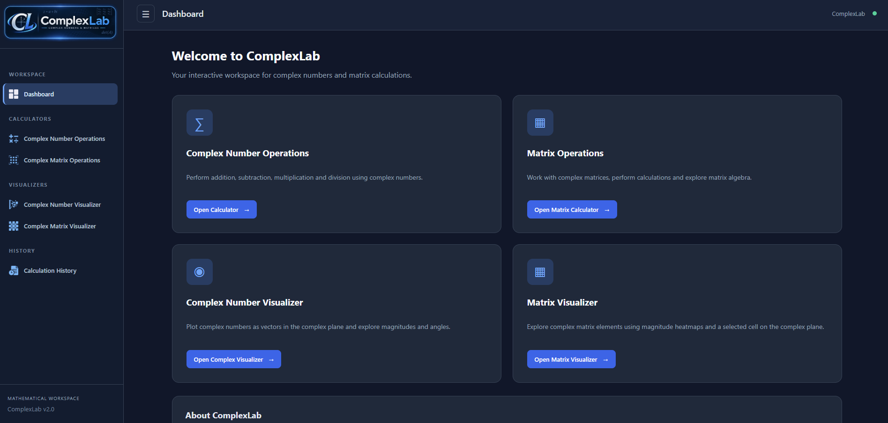
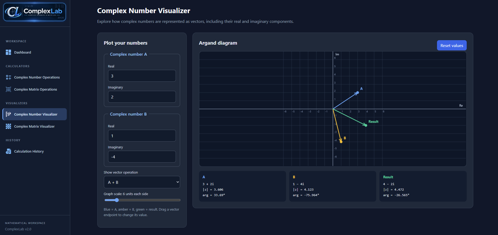

<div align="center">


# ComplexLab

**An interactive Java & Spring Boot workspace for complex numbers and complex matrices.**

Built around a university assignment originally developed in **2019**, extended into a responsive web application with interactive visualizers and persistent calculation history.

[Features](#features) · [Screenshots](#screenshots) · [Getting started](#getting-started) · [Project structure](#project-structure)

</div>

## Overview

ComplexLab focuses on **complex arithmetic** and **operations on matrices whose entries are complex numbers**. It combines a reusable mathematical core with a Spring Boot backend, server-rendered Thymeleaf pages, a responsive dashboard, and interactive visualizations in JavaScript.

## Features

### Complex Number Calculator

- Add, subtract, multiply, and divide complex numbers.
- Validate real and imaginary inputs and show formatted results.
- Save successful calculations to local history.

### Complex Matrix Calculator

- Add, subtract, and multiply matrices of complex numbers.
- Multiply a matrix by a complex scalar.
- Transpose and conjugate transpose.
- Compute the determinant, trace, and inverse where mathematically defined.
- Compute powers, identity matrices, and randomized matrices.
- Validate dimensions and input format (up to **10 × 10** for entered matrices).
- Save successful calculations to local history.

> **Matrix input format:** each row goes on a separate line, entries are separated by spaces, and each entry has the form `real:imaginary`. For example, `3:-2` represents `3 − 2i`.

### Complex Number Visualizer

- Plot complex numbers on the Argand plane.
- Visualize addition, subtraction, and multiplication as vectors.
- Drag vector endpoints to change values and adjust the graph scale.
- Inspect magnitude and argument.

### Complex Matrix Visualizer

- Visualize a matrix of complex entries using an interactive heatmap.
- Compare real and imaginary parts, magnitude, and argument.
- Inspect a selected cell on the complex plane.

### Calculation History

- Automatically persist successful calculations in a **local SQLite database**.
- Browse history by newest entry and filter by complex-number or matrix calculations.
- Remove unwanted records.

### Application UI

- Responsive dashboard with sidebar and reusable Thymeleaf fragments for navigation, topbar, and footer.
- Custom PNG navigation icons and a branded logo.

## Screenshots

Screenshots can be added to [`docs/screenshots/`](docs/screenshots/). The section below is ready to use once you capture images from the running application.

<!-- Uncomment each image as soon as its PNG file is added to docs/screenshots/.

### Dashboard


### Complex Number Calculator


### Complex Matrix Calculator


### Complex Number Visualizer


### Complex Matrix Visualizer


### Calculation History


-->

**Suggested screenshots:** Dashboard, Complex Number Calculator, Complex Matrix Calculator, both Visualizers, and Calculation History. See the [screenshots guide](docs/screenshots/README.md) for the exact filenames.

## Tech stack

| Layer | Technology |
| --- | --- |
| Language | Java 21 |
| Backend | Spring Boot 4.1.2, Spring MVC |
| Views | Thymeleaf, HTML, CSS |
| Client-side interactions | Vanilla JavaScript / Canvas |
| Persistence | Spring Data JPA, Hibernate ORM, SQLite JDBC |
| Build | Maven / Maven Wrapper |
| Tests | JUnit / Spring Boot Test |

## Getting started

### Prerequisites

- **JDK 21 or later** (the Maven project targets Java 21)
- **Maven** (or the included Maven Wrapper)
- A browser

### 1. Clone the repository

```bash
git clone https://github.com/KonKargas/ComplexLab.git
cd ComplexLab
```

> This example assumes the repository is published at `KonKargas/ComplexLab`. Update the URL if you choose a different repository name.

### 2. Create the local database directory

The directory `data/` is included in the repository with a `.gitkeep` file. The database file itself is **not** committed. The SQLite JDBC driver will create `data/complexlab.db` on first startup, provided that the directory exists and is writable.

### 3. Run the application

**Windows:**

```powershell
.\mvnw.cmd spring-boot:run
```

**macOS / Linux:**

```bash
./mvnw spring-boot:run
```

Or use Maven directly:

```bash
mvn spring-boot:run
```

Open **http://localhost:8080/** in your browser.

> The local SQLite path is relative to the application's working directory. If running from an IDE, make sure the working directory is the project root. Optionally override the database URL with the `COMPLEXLAB_DB_URL` environment variable (for example, `jdbc:sqlite:/absolute/path/complexlab.db`).

### 4. Run tests

```bash
./mvnw test
```

On Windows use `mvnw.cmd test` instead.

## Pages

| Page | Route |
| --- | --- |
| Dashboard | `/` |
| Complex Number Calculator | `/calculator` |
| Complex Matrix Calculator | `/matrix` |
| Complex Number Visualizer | `/visualizer` |
| Complex Matrix Visualizer | `/matrix-visualizer` |
| Calculation History | `/history` |

## Project structure

```text
ComplexLab/
├── data/                      # Local SQLite database (ignored by Git)
├── docs/screenshots/          # App screenshot gallery
├── src/
│   ├── main/
│   │   ├── java/com/kkargas/complexlab/
│   │   │   ├── controller/    # MVC controllers
│   │   │   ├── dto/           # Form and response models
│   │   │   ├── enums/         # Available operations
│   │   │   ├── model/         # Complex arithmetic, matrices, history entity
│   │   │   ├── repository/    # History persistence
│   │   │   └── service/       # Mathematical and persistence services
│   │   └── resources/
│   │       ├── static/        # CSS, JavaScript, PNG icons, logo
│   │       ├── templates/     # Pages and shared Thymeleaf fragments
│   │       └── application.properties
│   └── test/                  # Unit and application tests
├── .gitignore
├── pom.xml
├── mvnw
└── mvnw.cmd
```

## Data & privacy

Calculation history is stored locally in **`data/complexlab.db`**. This file, its SQLite journals, build outputs, and IDE metadata are excluded via `.gitignore` and are not part of the published source archive.

Back up the database before changing your schema or deleting local application data. The project currently uses `spring.jpa.hibernate.ddl-auto=update`, which is convenient for development but is not a replacement for production database migrations.

## Project background

ComplexLab is a modern web-based continuation of an academic project from 2019. The main goal remains the same: make it easy to calculate with **complex numbers and matrices of complex numbers**, with practical visual feedback and an optional calculation history.

## Author

Developed by **Konstantinos Kargas**  
Website: [kkargas.com](https://kkargas.com)  
GitHub: [KonKargas](https://github.com/KonKargas)

## License

No license has been selected for this repository yet. A license file can be added when a distribution license is chosen.
